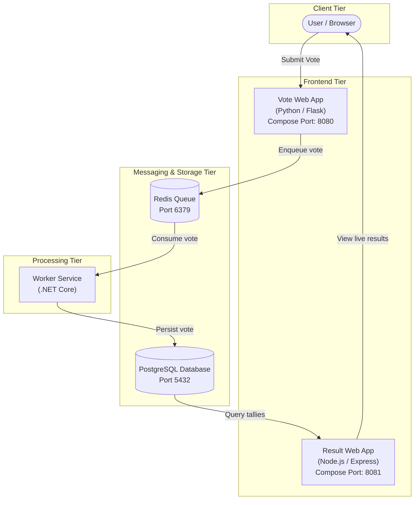
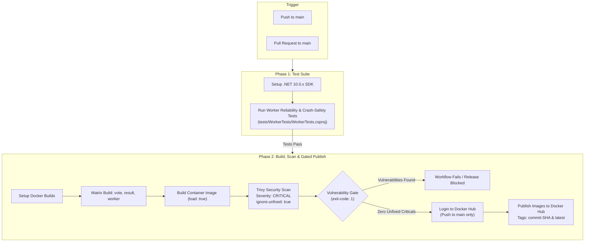
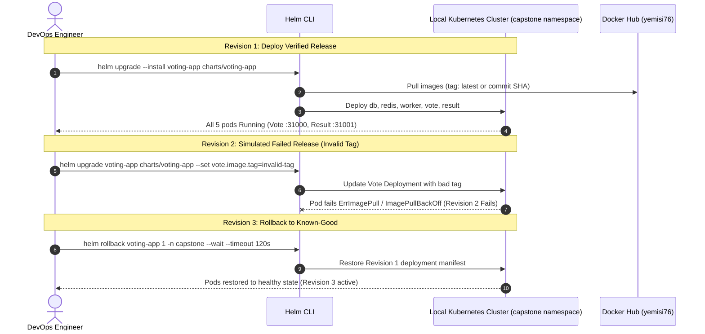

# Example Voting App

A distributed voting application running across multiple containerized services.

## Overview

The Example Voting App is a multi-tier microservices application demonstrating containerization, automated testing, security scanning, CI/CD pipeline integration, and Kubernetes orchestration via Helm.

* **Vote Web App**: Front-end voting interface written in Python (Flask) allowing users to vote between two options.
* **Redis Queue**: In-memory message queue collecting incoming votes.
* **Worker Service**: Background processing service written in .NET Core consuming votes from Redis and persisting them into PostgreSQL.
* **PostgreSQL Database**: Relational database storing persistent vote records.
* **Result Web App**: Real-time reporting front-end written in Node.js (Express / Angular) displaying voting tallies.

### Architecture Diagram




### Application Notes

* The voting application accepts one vote per client browser session. Additional votes submitted from the same browser update the voter's existing choice.
* The original static Kubernetes specifications are preserved under [`k8s-specifications/`](k8s-specifications/) for reference.

---

## DevOps Capstone 1: Acceptance Criteria Alignment

This project is evaluated against the *DevOps Capstone Projects (Beginner Edition: Ship It and Keep It Running)* specifications (Modules 5–12). The table below summarizes the repository status against all five required steps and the completion criteria.

| Step | Requirement in Brief | Implementation in Repository | Verification Status |
| :--- | :--- | :--- | :--- |
| **1. Run locally** | Fork repo, run `docker compose up`. Cast a vote and see it counted. | `docker-compose.yml` with healthchecks, Vote (:8080), Result (:8081). | **Verified** (HTTP 200, vote cast and tallied). |
| **2. Containerize safely** | Pin base images, run as non-root, add `.dockerignore`, build all images. | Dockerfiles in `vote/`, `result/`, `worker/` with version tags, non-root users, `.dockerignore`. | **Verified** (Hardened images build and run; version-tagged, not SHA-pinned). |
| **3. Terraform k8s cluster** | Terraform builds a Kubernetes cluster in default VPC, destroy and recreate. | Manifests in `terraform/` (`vpc.tf`, `main.tf`, `iam.tf`) targeting default VPC. | **Code Ready / Cloud Unapplied** (Discovers default VPC; validated on local `kind`). |
| **4. Automate with GitHub Actions** | Push triggers tests, Trivy scan, build and push tagged with commit SHA. | `.github/workflows/ci.yaml` runs worker tests, Trivy security gate, and pushes to Docker Hub. | **CI Verified / CD Outstanding** (Builds/scans/pushes; does not auto-deploy to k8s). |
| **5. Deploy and roll back with Helm** | One chart, one values file. Ship a bad release on purpose, then run `helm rollback`. | Helm chart under `charts/voting-app/`, single `values.yaml`, tested failure & rollback. | **Verified on Local Cluster** (Revision 1 deployed, Revision 2 failed, Revision 3 restored). |

### Hand In & "Done Means" Alignment

* **Forked repo with clear README**: Implemented.
* **Architecture diagram**: Included above (both original Excalidraw reference and Mermaid diagram).
* **Terraform code and one Helm chart**: Present in [`terraform/`](terraform/) and [`charts/voting-app/`](charts/voting-app/).
* **Working GitHub Actions pipeline**: CI pipeline verified; automated CD deployment to Kubernetes is listed under outstanding work.
* **Secrets in Git**: **Partially Met / Known Gap**. Docker Hub registry credentials (`DOCKERHUB_USERNAME`, `DOCKERHUB_TOKEN`) are managed outside Git via GitHub Actions secrets. However, default database credentials (`POSTGRES_USER` and `POSTGRES_PASSWORD` set to `postgres`) remain configured in plain text in [`charts/voting-app/values.yaml`](charts/voting-app/values.yaml) and [`docker-compose.yml`](docker-compose.yml).
* **Rollback shown live**: Verified locally with Helm revision history.

---

## Step 1: Local Development with Docker Compose

Docker Compose runs the complete stack locally with live healthchecks.

### Quickstart

Build and start all services in the background:

```bash
docker compose up --build -d
```

Verify service status:

```bash
docker compose ps
```

### Verified Access URLs (Docker Compose)

Host port mappings defined in `docker-compose.yml` bind directly to localhost:

| Service | Host URL | Container Port | Description |
| :--- | :--- | :--- | :--- |
| **Vote Web App** | [http://localhost:8080](http://localhost:8080) | 80 | Web voting interface |
| **Result Web App** | [http://localhost:8081](http://localhost:8081) | 80 | Live vote result dashboard |

### Optional: Seed Initial Votes

To generate synthetic test votes using the seed data generator:

```bash
docker compose --profile seed up -d
```

### Stopping the Services

```bash
docker compose down
```

---

## Step 2: Safe Containerization

All application services have been hardened according to best practices:

1. **Vote Service ([`vote/Dockerfile`](vote/Dockerfile))**:
   - Base image: `python:3.11-slim` (pinned by version/flavor tag; not pinned by immutable digest).
   - Non-root execution: Dedicated `appuser` (UID/GID `10001`).
   - Context hygiene: Excludes cache, bytecode, and unneeded files via [`vote/.dockerignore`](vote/.dockerignore).
   - Production server: Served via Gunicorn with 4 workers.
2. **Result Service ([`result/Dockerfile`](result/Dockerfile))**:
   - Base image: `node:22-slim` (pinned by version/flavor tag; not pinned by immutable digest) with upgraded OS packages.
   - Process manager: Wrapped with `tini` for signal handling and zombie process reaping.
   - Non-root execution: Built-in `node` user.
   - Context hygiene: Excludes local `node_modules` and tests via [`result/.dockerignore`](result/.dockerignore).
3. **Worker Service ([`worker/Dockerfile`](worker/Dockerfile))**:
   - Multi-stage build: Compiles via `mcr.microsoft.com/dotnet/sdk:10.0` and publishes to runtime image `mcr.microsoft.com/dotnet/runtime:10.0` (pinned by version tag; not pinned by immutable digest).
   - Non-root execution: Dedicated `appuser` (UID/GID `10001`).
   - Context hygiene: Excludes build artifacts via [`worker/.dockerignore`](worker/.dockerignore).

---

## Step 3: Kubernetes Cluster Infrastructure with Terraform

The infrastructure code under [`terraform/`](terraform/) targets an Amazon EKS cluster and supporting networking:

* **Default VPC Discovery ([`terraform/vpc.tf`](terraform/vpc.tf))**:
  - In alignment with the Capstone 1 brief ("Terraform builds a Kubernetes (k8s) cluster in the default VPC"), `vpc.tf` does **not** create a new VPC.
  - Instead, it queries existing AWS default VPC and subnet resources using `data "aws_vpc" "default"` and `data "aws_subnets" "default"`.
  - It filters out availability zones known to lack EKS control plane support (such as `us-east-1e`) to assemble a list of suitable default subnet IDs.
* **EKS Cluster & Managed Node Group ([`terraform/main.tf`](terraform/main.tf))**:
  - Configures `aws_eks_cluster` directly inside the discovered default VPC subnets (`subnet_ids = local.suitable_subnet_ids`).
  - Provisions an `aws_eks_node_group` attached to the same default VPC subnets.
* **IAM Roles & Policies ([`terraform/iam.tf`](terraform/iam.tf))**:
  - Configures standard cluster policy (`AmazonEKSClusterPolicy`, `AmazonEKSVPCResourceController`) and worker node policies (`AmazonEKSWorkerNodePolicy`, `AmazonEKS_CNI_Policy`, `AmazonEC2ContainerRegistryReadOnly`).

> [!IMPORTANT]
> **Cloud Provisioning Status**:
> The Terraform configurations have **not** been applied (`terraform apply`) to an AWS cloud environment, avoiding recurring cloud hosting costs. Cluster validation and rollback workflows were demonstrated on a local `kind` Kubernetes cluster. Testing the complete cluster lifecycle (apply, destroy, and recreate from code) against AWS remains documented future work.

---

## Step 4: Automated CI/CD Pipeline (GitHub Actions)

The workflow in [`.github/workflows/ci.yaml`](.github/workflows/ci.yaml) runs on pushes and pull requests targeting `main`.

### Workflow Architecture



### Pipeline Details

1. **Worker Tests**:
   - Executes the automated test suite under [`tests/WorkerTests/WorkerTests.csproj`](tests/WorkerTests/WorkerTests.csproj).
   - Validates worker crash handling, reconnect logic, and database insertion reliability.
2. **Matrix Container Build**:
   - Builds local container images using Docker Buildx (`load: true`) for `vote`, `result`, and `worker`.
3. **Trivy Vulnerability Gate**:
   - Scans each built image using `aquasecurity/trivy-action@v0.36.0`.
   - Enforces `severity: 'CRITICAL'` and `ignore-unfixed: true` with `exit-code: '1'`.
4. **Gated Image Publish**:
   - Triggers only on direct pushes or merges to `main`.
   - Authenticates using repository secrets `DOCKERHUB_USERNAME` and `DOCKERHUB_TOKEN`.
   - Pushes verified images to Docker Hub under `yemisi76/examplevotingapp_<service>`.
   - Images are tagged with both the Git commit SHA and `latest`.

> [!NOTE]
> **Distinction Between CI Publishing and CD Deployment**:
> The existing GitHub Actions workflow automates Continuous Integration (testing, building, security scanning, and registry publishing). It does **not** automatically deploy the application to a live Kubernetes cluster. Automated deployment (Continuous Delivery) is identified as outstanding work.

---

## Step 5: Helm Deployment & Rollback

The application is packaged into a unified Helm chart under [`charts/voting-app`](charts/voting-app) managed by a single [`values.yaml`](charts/voting-app/values.yaml).

### Chart Structure

```
charts/voting-app/
├── Chart.yaml
├── values.yaml
└── templates/
    ├── _helpers.tpl
    ├── db-deployment.yaml
    ├── db-service.yaml
    ├── redis-deployment.yaml
    ├── redis-service.yaml
    ├── result-deployment.yaml
    ├── result-service.yaml
    ├── vote-deployment.yaml
    ├── vote-service.yaml
    └── worker-deployment.yaml
```

### Deployment and Rollback Lifecycle



### Validation and Linting

```bash
helm lint charts/voting-app
helm template voting-app charts/voting-app
```

### Local Cluster Installation

Deploy the chart to the `capstone` namespace on the local cluster:

```bash
helm upgrade --install voting-app charts/voting-app \
  --namespace capstone \
  --create-namespace
```

To deploy specific images tagged with a Git commit SHA:

```bash
helm upgrade --install voting-app charts/voting-app \
  --namespace capstone \
  --create-namespace \
  --set vote.image.tag=87ee448fe4849c162306a2b9f71c1b411a504c16 \
  --set result.image.tag=87ee448fe4849c162306a2b9f71c1b411a504c16 \
  --set worker.image.tag=87ee448fe4849c162306a2b9f71c1b411a504c16
```

### Status and Workload Verification

```bash
helm history voting-app -n capstone
kubectl get deployments,services,pods -n capstone
kubectl rollout status deployment/vote -n capstone --timeout=120s
kubectl rollout status deployment/result -n capstone --timeout=120s
kubectl rollout status deployment/worker -n capstone --timeout=120s
```

### Kubernetes Service Endpoints and Access

The chart exposes front-end services using Kubernetes `NodePort` service objects:

| Service | Service Port | Target Port | NodePort | Cluster DNS |
| :--- | :--- | :--- | :--- | :--- |
| **Vote Service** | 8080 | 80 | 31000 | `vote.capstone.svc.cluster.local` |
| **Result Service** | 8081 | 80 | 31001 | `result.capstone.svc.cluster.local` |

> [!NOTE]
> **Accessing NodePorts on Local Clusters (`kind`)**:
> Unlike Docker Compose which maps ports directly to `localhost`, standard `kind` cluster nodes run inside a Docker container without automatic host port forwarding. To access the services from your host workstation:
>
> * **Option A: Kubectl Port-Forward (Recommended)**:
>   ```bash
>   kubectl port-forward svc/vote 8080:8080 -n capstone
>   kubectl port-forward svc/result 8081:8081 -n capstone
>   ```
>   Services will then be reachable at [http://localhost:8080](http://localhost:8080) and [http://localhost:8081](http://localhost:8081).
>
> * **Option B: Node IP & NodePort**:
>   Query the node internal IP via `kubectl get nodes -o wide` and access `http://<NodeInternalIP>:31000` (Vote) or `http://<NodeInternalIP>:31001` (Result) from within the cluster network.

### Rollback of a Failed Release

1. Review release history:
   ```bash
   helm history voting-app -n capstone
   ```
2. Roll back to the last known-good revision:
   ```bash
   helm rollback voting-app 1 -n capstone --wait --timeout 120s
   ```
3. Confirm workload recovery:
   ```bash
   kubectl rollout status deployment/vote -n capstone --timeout=120s
   kubectl get pods -n capstone
   ```

---

## Validation Evidence

The following operational evidence was verified during capstone testing:

* **Helm Chart Linting & Templates**:
  - `helm lint charts/voting-app` passed with 0 errors.
  - `helm template voting-app charts/voting-app` rendered valid Kubernetes manifests.
* **Workload Health**:
  - All 5 workloads (`db`, `redis`, `worker`, `vote`, `result`) in the `capstone` namespace reached `Running` status on the local cluster.
* **HTTP Endpoint Health**:
  - HTTP `200 OK` verified on the Vote service endpoint.
  - HTTP `200 OK` verified on the Result service endpoint.
* **Inter-Service Communication**:
  - Worker console logs verified successful database connection (`Connected to db`) and active Redis resolution (`Connecting to redis` / `Found redis at <ip>`).
* **Simulated Bad Release & Rollback**:
  - **Revision 1**: Initial deployment of verified application release.
  - **Revision 2**: Triggered intentional failure via an invalid Vote container image tag, producing `ImagePullBackOff` and a failed rollout.
  - **Revision 3**: Executed `helm rollback voting-app 1 -n capstone`, successfully restoring all pods to `Running` status under Revision 3.
* **CI/CD Security Gates**:
  - Worker crash-safety tests passed in GitHub Actions.
  - Trivy scan passed with 0 actionable `CRITICAL` vulnerabilities across all three application images before publishing to Docker Hub.

---

## Outstanding Work & Gaps Against Brief

To achieve full alignment with the Capstone 1 brief and stretch objectives, the following items remain outstanding:

1. **Cloud Kubernetes Cluster Provisioning (Step 3)**:
   - Terraform files targeting the default VPC are complete but have not been run against an active AWS subscription.
   - Outstanding action: Run `terraform init` and `terraform apply` to provision AWS EKS, test destruction and recreation from code, and deploy the Helm release to EKS.
2. **Automated CD Deployment in GitHub Actions (Step 4 / Done Means)**:
   - The current workflow in `.github/workflows/ci.yaml` builds, scans, and pushes images, but does not deploy them to a cluster.
   - Outstanding action: Add a deployment job or integrate a GitOps controller (such as Argo CD, as listed under optional stretch).
3. **Persistent Storage for Stateful Services (Known Limitation)**:
   - PostgreSQL and Redis deployments in `charts/voting-app` currently mount ephemeral `emptyDir: {}` storage volumes.
   - Outstanding action: Replace `emptyDir` with `PersistentVolumeClaim` (PVC) backed by cloud storage (e.g., AWS EBS CSI driver).
4. **Production Secrets Management (Secret Hygiene Gap)**:
   - Default database credentials (`POSTGRES_USER`, `POSTGRES_PASSWORD`) are currently checked into Git in `values.yaml` and `docker-compose.yml`.
   - Outstanding action: Remove plain text credentials from Git and integrate an external secrets manager (such as AWS Secrets Manager or HashiCorp Vault via External Secrets Operator).
