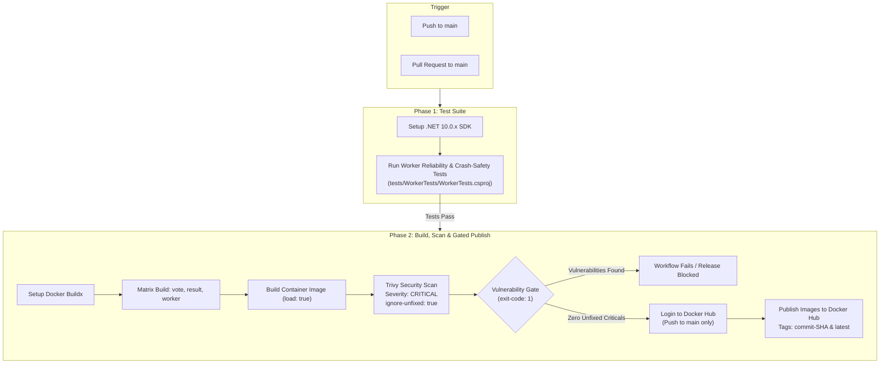
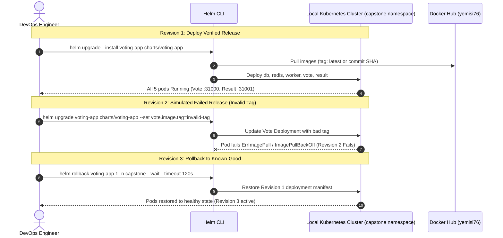
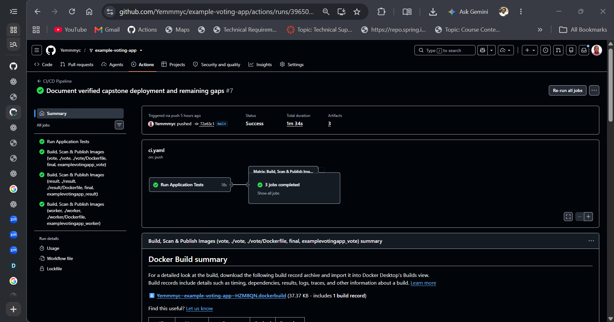
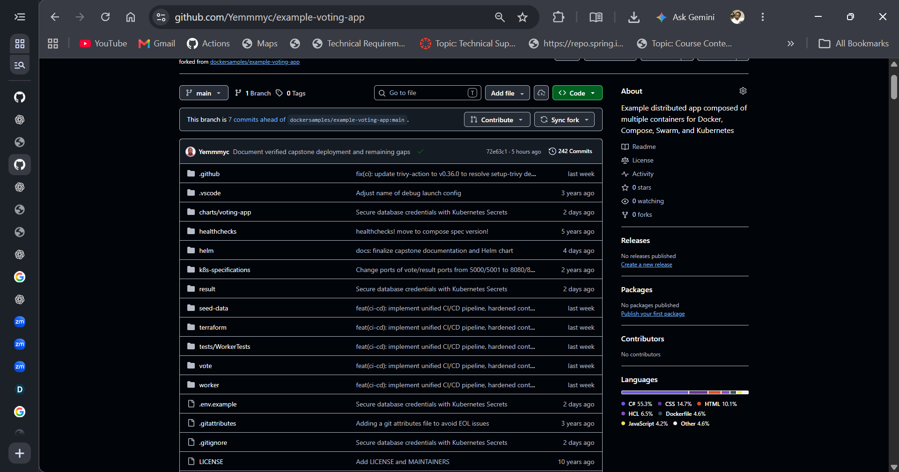
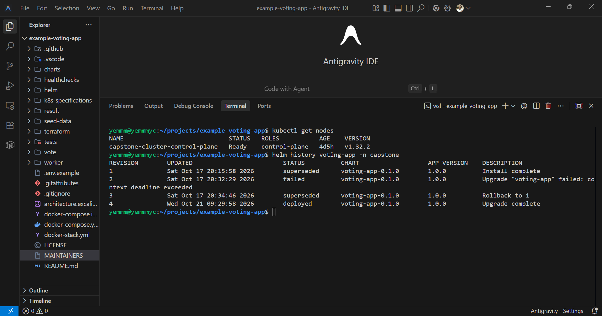
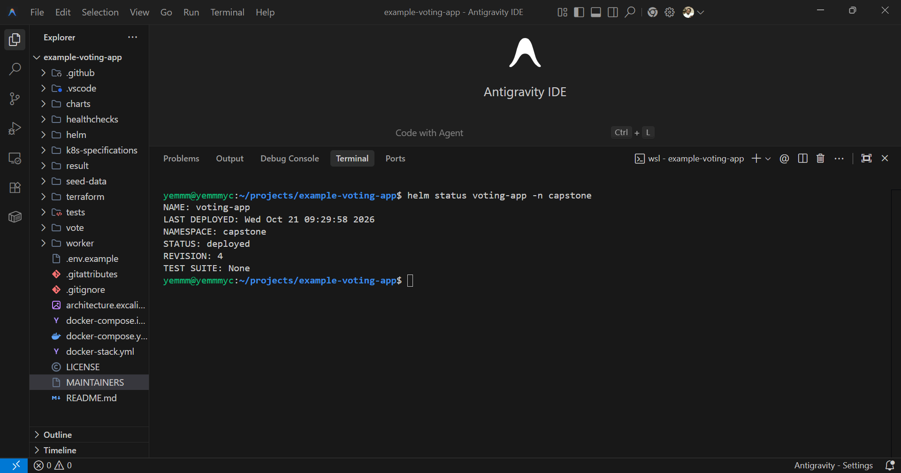

# Example Voting App

A distributed voting application running across multiple containerized services.

## Overview

The Example Voting App is a multi-tier microservices application demonstrating containerization, automated testing, security scanning, CI/CD pipeline integration, and Kubernetes orchestration via Helm.

* **Vote Web App**: Front-end voting interface written in Python (Flask) allowing users to vote between two options.
* **Redis Queue**: In-memory message queue collecting incoming votes.
* **Worker Service**: Background processing service written in .NET Core consuming votes from Redis and persisting them into PostgreSQL.
* **PostgreSQL Database**: Relational database storing persistent vote records.
* **Result Web App**: Real-time reporting front-end written in Node.js (Express / Angular) displaying voting tallies.

### Architecture Diagram


### Application Notes

* The voting application accepts one vote per client browser session. Additional votes submitted from the same browser update the voter's existing choice.
* The original static Kubernetes specifications are preserved under [`k8s-specifications/`](k8s-specifications/) for reference.

---

## DevOps Capstone 1: Acceptance Criteria Alignment

This project is evaluated against the *DevOps Capstone Projects (Beginner Edition: Ship It and Keep It Running)* specifications (Modules 5–12). The table below summarizes the repository status against all five required steps and the completion criteria.

| Step | Requirement in Brief | Implementation in Repository | Verification Status |
| :--- | :--- | :--- | :--- |
| **1. Run locally** | Fork repo, run `docker compose up`. Cast a vote and see it counted. | `docker-compose.yml` with healthchecks, Vote (:8080), Result (:8081). | **Verified** (HTTP 200, vote cast and tallied). |
| **2. Containerize safely** | Pin base images, run as non-root, add `.dockerignore`, build all images. | Dockerfiles in `vote/`, `result/`, `worker/` with version tags, non-root users, `.dockerignore`. | **Verified** (Hardened images build and run; version-tagged, not SHA-pinned). |
| **3. Terraform k8s cluster** | Terraform builds a Kubernetes cluster in default VPC, destroy and recreate. | Manifests in `terraform/` (`vpc.tf`, `main.tf`, `iam.tf`) targeting default VPC. | **Code Ready / Cloud Unapplied** (Discovers default VPC; validated on local `kind`). |
| **4. Automate with GitHub Actions** | Push triggers tests, Trivy scan, build and push tagged with commit SHA. | `.github/workflows/ci.yaml` runs worker tests, Trivy security gate, and pushes to Docker Hub. | **CI Verified (commit 9aff4d6) / CD Outstanding** (Builds/scans/pushes; does not auto-deploy to k8s). |
| **5. Deploy and roll back with Helm** | One chart, one values file. Ship a bad release on purpose, then run `helm rollback`. | Helm chart under `charts/voting-app/`, single `values.yaml`, tested failure & rollback; upgraded to Revision 4 with Secret. | **Verified on Local Cluster** (Revisions 1–3 tested deploy/fail/rollback; Revision 4 deployed 1/1 ready). |

### Hand In Deliverables Status (Page 5 Brief)

* **Forked repo with a clear README**: Present (documents architecture, local run, CI pipeline, Helm operations, and explicit gaps).
* **Terraform code and one Helm chart**: Present in [`terraform/`](terraform/) (targets default VPC EKS) and [`charts/voting-app/`](charts/voting-app/) (unified chart & `values.yaml`).
* **A working GitHub Actions pipeline**: Present in [`.github/workflows/ci.yaml`](.github/workflows/ci.yaml) (automates application tests, container builds, Trivy security scan, and Docker Hub publishing).
* **Architecture diagram**: Present (includes both the original Excalidraw reference and dedicated Mermaid diagrams).

### "Done Means" Authoritative Assessment (Page 5 Brief)

The project is assessed against the four completion criteria defined in the brief:

1. **One push builds, scans and deploys**: **NOT YET MET (Outstanding Gap)**
   - The GitHub Actions workflow validated code, passed worker crash-safety tests, passed Trivy security scans, and pushed verified images to Docker Hub on commit `9aff4d6`.
   - Automated CD deployment to a live Kubernetes cluster is **not** implemented; the pipeline stops at registry publishing.
2. **The environment rebuilds from code**: **PARTIALLY MET (Local Demonstrated / Cloud Outstanding)**
   - Local deployment and workload recovery were verified using Docker Compose and Helm (including recovery from local container runtime metadata desynchronization and successful database state restore).
   - Cloud environment recreation from code (provisioning, destroying, and recreating the AWS EKS cluster via Terraform) has **not** been demonstrated because AWS infrastructure has not been provisioned.
3. **No secrets in Git**: **PARTIALLY MET (Ongoing Secret Hygiene Gap)**
   - Docker Hub credentials are appropriately secured via GitHub Actions secrets.
   - Commit `9aff4d6` decoupled production database credentials from Helm manifests by consuming a pre-created Kubernetes Secret (`voting-app-db-secret`) and updated application code to read from environment variables.
   - However, default/fallback credentials remain in tracked local configuration files (`.env.example` and `charts/voting-app/values.yaml`), and Git history retains prior commits with credentials. Full compliance requires adopting a production secrets manager (e.g., AWS Secrets Manager or HashiCorp Vault via External Secrets Operator) and credential rotation.
4. **Rollback is shown live**: **MET ON LOCAL CLUSTER (Cloud Demonstration Pending)**
   - Verified on local `kind` cluster (`capstone-cluster`): Revision 1 deployed healthy workloads, Revision 2 failed due to an intentional bad image tag (`ImagePullBackOff`), and `helm rollback voting-app 1` generated Revision 3, restoring healthy workloads. Following this, Revision 4 was upgraded with external database Secret integration.
   - Demonstrating rollback on provisioned AWS EKS remains pending cloud deployment.

---

## Step 1: Local Development with Docker Compose

Docker Compose runs the complete stack locally with live healthchecks.

### Quickstart

Build and start all services in the background:

```bash
docker compose up --build -d
```

Verify service status:

```bash
docker compose ps
```

### Verified Access URLs (Docker Compose)

Host port mappings defined in `docker-compose.yml` bind directly to localhost:

| Service | Host URL | Container Port | Description |
| :--- | :--- | :--- | :--- |
| **Vote Web App** | [http://localhost:8080](http://localhost:8080) | 80 | Web voting interface |
| **Result Web App** | [http://localhost:8081](http://localhost:8081) | 80 | Live vote result dashboard |

### Optional: Seed Initial Votes

To generate synthetic test votes using the seed data generator:

```bash
docker compose --profile seed up -d
```

### Stopping the Services

```bash
docker compose down
```

---

## Step 2: Safe Containerization

All application services have been hardened according to best practices:

1. **Vote Service ([`vote/Dockerfile`](vote/Dockerfile))**:
   - Base image: `python:3.11-slim` (pinned by version/flavor tag; not pinned by immutable digest).
   - Non-root execution: Dedicated `appuser` (UID/GID `10001`).
   - Context hygiene: Excludes cache, bytecode, and unneeded files via [`vote/.dockerignore`](vote/.dockerignore).
   - Production server: Served via Gunicorn with 4 workers.
2. **Result Service ([`result/Dockerfile`](result/Dockerfile))**:
   - Base image: `node:22-slim` (pinned by version/flavor tag; not pinned by immutable digest) with upgraded OS packages.
   - Process manager: Wrapped with `tini` for signal handling and zombie process reaping.
   - Non-root execution: Built-in `node` user.
   - Context hygiene: Excludes local `node_modules` and tests via [`result/.dockerignore`](result/.dockerignore).
3. **Worker Service ([`worker/Dockerfile`](worker/Dockerfile))**:
   - Multi-stage build: Compiles via `mcr.microsoft.com/dotnet/sdk:10.0` and publishes to runtime image `mcr.microsoft.com/dotnet/runtime:10.0` (pinned by version tag; not pinned by immutable digest).
   - Non-root execution: Dedicated `appuser` (UID/GID `10001`).
   - Context hygiene: Excludes build artifacts via [`worker/.dockerignore`](worker/.dockerignore).

---

## Step 3: Kubernetes Cluster Infrastructure with Terraform

The infrastructure code under [`terraform/`](terraform/) targets an Amazon EKS cluster and supporting networking:

* **Default VPC Discovery ([`terraform/vpc.tf`](terraform/vpc.tf))**:
  - In alignment with the Capstone 1 brief ("Terraform builds a Kubernetes (k8s) cluster in the default VPC"), `vpc.tf` does **not** create a new VPC.
  - Instead, it queries existing AWS default VPC and subnet resources using `data "aws_vpc" "default"` and `data "aws_subnets" "default"`.
  - It filters out availability zones known to lack EKS control plane support (such as `us-east-1e`) to assemble a list of suitable default subnet IDs.
* **EKS Cluster & Managed Node Group ([`terraform/main.tf`](terraform/main.tf))**:
  - Configures `aws_eks_cluster` directly inside the discovered default VPC subnets (`subnet_ids = local.suitable_subnet_ids`).
  - Provisions an `aws_eks_node_group` attached to the same default VPC subnets.
* **IAM Roles & Policies ([`terraform/iam.tf`](terraform/iam.tf))**:
  - Configures standard cluster policy (`AmazonEKSClusterPolicy`, `AmazonEKSVPCResourceController`) and worker node policies (`AmazonEKSWorkerNodePolicy`, `AmazonEKS_CNI_Policy`, `AmazonEC2ContainerRegistryReadOnly`).

> [!IMPORTANT]
> **Cloud Provisioning Status**:
> The Terraform configurations have **not** been applied (`terraform apply`) to an AWS cloud environment, avoiding recurring cloud hosting costs. Cluster validation and rollback workflows were demonstrated on a local `kind` Kubernetes cluster. Testing the complete cluster lifecycle (apply, destroy, and recreate from code) against AWS remains documented future work.

---

## Step 4: Automated CI/CD Pipeline (GitHub Actions)

The workflow in [`.github/workflows/ci.yaml`](.github/workflows/ci.yaml) runs on pushes and pull requests targeting `main`.

### Workflow Architecture



### Pipeline Details

1. **Worker Tests**:
   - Executes the automated test suite under [`tests/WorkerTests/WorkerTests.csproj`](tests/WorkerTests/WorkerTests.csproj).
   - Validates worker crash handling, reconnect logic, and database insertion reliability.
2. **Matrix Container Build**:
   - Builds local container images using Docker Buildx (`load: true`) for `vote`, `result`, and `worker`.
3. **Trivy Vulnerability Gate**:
   - Scans each built image using `aquasecurity/trivy-action@v0.36.0`.
   - Enforces `severity: 'CRITICAL'` and `ignore-unfixed: true` with `exit-code: '1'`.
4. **Gated Image Publish**:
   - Triggers only on direct pushes or merges to `main`.
   - Authenticates using repository secrets `DOCKERHUB_USERNAME` and `DOCKERHUB_TOKEN`.
   - Pushes verified images to Docker Hub under `yemisi76/examplevotingapp_<service>`.
   - Images are tagged with both the Git commit SHA and `latest`.

> [!NOTE]
> **Distinction Between CI Publishing and CD Deployment**:
> The existing GitHub Actions workflow automates Continuous Integration (testing, building, security scanning, and registry publishing). It does **not** automatically deploy the application to a live Kubernetes cluster. Automated deployment (Continuous Delivery) is identified as outstanding work.

---

## Step 5: Helm Deployment & Rollback

The application is packaged into a unified Helm chart under [`charts/voting-app`](charts/voting-app) managed by a single [`values.yaml`](charts/voting-app/values.yaml).

### Chart Structure

```
charts/voting-app/
├── Chart.yaml
├── values.yaml
└── templates/
    ├── _helpers.tpl
    ├── db-deployment.yaml
    ├── db-service.yaml
    ├── redis-deployment.yaml
    ├── redis-service.yaml
    ├── result-deployment.yaml
    ├── result-service.yaml
    ├── vote-deployment.yaml
    ├── vote-service.yaml
    └── worker-deployment.yaml
```

### Deployment and Rollback Lifecycle



### Validation and Linting

```bash
helm lint charts/voting-app
helm template voting-app charts/voting-app
```

### Local Cluster Installation

#### 1. Database Secret Pre-requisite

> [!IMPORTANT]
> **Secret Pre-requisite**: This Helm chart does **not** create or template a Kubernetes Secret containing database credentials. The Secret **must exist in the target namespace before installing or upgrading the chart** (either matching the default name `<release-fullname>-db-secret`, or specified via `db.auth.existingSecret`).
>
> **Required Secret Keys**: The Secret must supply all five keys consumed by the database, worker, and Result deployments:
> - `postgres-user`: PostgreSQL database username
> - `postgres-password`: PostgreSQL database password
> - `postgres-db`: Target database name (e.g. `postgres`)
> - `worker-connection-string`: Connection string for the .NET worker (e.g. `Server=db;Username=postgres;Password=<STRONG_PASSWORD>;Database=postgres;`)
> - `result-database-url`: Connection URL for the Node.js Result service (e.g. `postgres://postgres:<STRONG_PASSWORD>@db/postgres`)
>
> **Secret Hygiene**: Real credentials must **never** be committed to Git. The example command below uses placeholder values:
> ```bash
> kubectl create secret generic voting-app-db-secret \
>   --namespace capstone \
>   --from-literal=postgres-user=postgres \
>   --from-literal=postgres-password="<STRONG_PASSWORD>" \
>   --from-literal=postgres-db=postgres \
>   --from-literal=worker-connection-string="Server=db;Username=postgres;Password=<STRONG_PASSWORD>;Database=postgres;" \
>   --from-literal=result-database-url="postgres://postgres:<STRONG_PASSWORD>@db/postgres"
> ```

#### 2. Chart Deployment and Upgrades

Deploy or upgrade the chart to the `capstone` namespace on the local cluster using images tagged with the verified Git commit SHA:

```bash
helm upgrade --install voting-app charts/voting-app \
  --namespace capstone \
  --create-namespace \
  --set vote.image.tag=9aff4d6d7ac83a1011066ae4e74039e937dc9d7a \
  --set result.image.tag=9aff4d6d7ac83a1011066ae4e74039e937dc9d7a \
  --set worker.image.tag=9aff4d6d7ac83a1011066ae4e74039e937dc9d7a \
  --wait \
  --timeout 180s
```

### Status and Workload Verification

```bash
helm history voting-app -n capstone
kubectl get deployments,services,pods -n capstone
kubectl rollout status deployment/vote -n capstone --timeout=120s
kubectl rollout status deployment/result -n capstone --timeout=120s
kubectl rollout status deployment/worker -n capstone --timeout=120s
```

### Kubernetes Service Endpoints and Access

The chart exposes front-end services using Kubernetes `NodePort` service objects:

| Service | Service Port | Target Port | NodePort | Cluster DNS |
| :--- | :--- | :--- | :--- | :--- |
| **Vote Service** | 8080 | 80 | 31000 | `vote.capstone.svc.cluster.local` |
| **Result Service** | 8081 | 80 | 31001 | `result.capstone.svc.cluster.local` |

> [!NOTE]
> **Accessing NodePorts on Local Clusters (`kind`)**:
> Unlike Docker Compose which maps ports directly to `localhost`, standard `kind` cluster nodes run inside a Docker container without automatic host port forwarding. To access the services from your host workstation:
>
> * **Option A: Kubectl Port-Forward (Recommended)**:
>   ```bash
>   kubectl port-forward svc/vote 8080:8080 -n capstone
>   kubectl port-forward svc/result 8081:8081 -n capstone
>   ```
>   Services will then be reachable at [http://localhost:8080](http://localhost:8080) and [http://localhost:8081](http://localhost:8081).
>
> * **Option B: Node IP & NodePort**:
>   Query the node internal IP via `kubectl get nodes -o wide` and access `http://<NodeInternalIP>:31000` (Vote) or `http://<NodeInternalIP>:31001` (Result) from within the cluster network.

### Rollback of a Failed Release

1. Review release history:
   ```bash
   helm history voting-app -n capstone
   ```
2. Roll back to the last known-good revision:
   ```bash
   helm rollback voting-app 1 -n capstone --wait --timeout 120s
   ```
3. Confirm workload recovery:
   ```bash
   kubectl rollout status deployment/vote -n capstone --timeout=120s
   kubectl get pods -n capstone
   ```

---

## Validation Evidence

The following operational evidence was verified during capstone testing:

* **Helm Chart Linting & Templates**:
  - `helm lint charts/voting-app` passed with 0 errors.
  - `helm template voting-app charts/voting-app` rendered valid Kubernetes manifests with `valueFrom.secretKeyRef` database environment variables.
* **Workload Health (Helm Revision 4)**:
  - All 5 application deployments (`db`, `redis`, `worker`, `vote`, `result`) in the `capstone` namespace reached `1/1 Ready` and `Running` status on the local cluster following `helm upgrade voting-app charts/voting-app -n capstone --wait --timeout 180s`.
* **HTTP Endpoint Health**:
  - Docker Compose endpoints validated: HTTP `200 OK` on Vote ([http://localhost:8080](http://localhost:8080)) and Result ([http://localhost:8081](http://localhost:8081)).
  - Kubernetes NodePort endpoints validated: HTTP `200 OK` verified on Vote (:31000) and Result (:31001).
* **Inter-Service Communication & Database State**:
  - Worker console logs verified active Redis queue resolution and persistent database connection.
  - Result service verified connecting to PostgreSQL and resolving the `public.votes` relation.
  - A local PostgreSQL database dump was executed prior to the Helm upgrade, and the saved vote row was restored and verified in `public.votes` afterward.
* **Kind Cluster Runtime Recovery**:
  - The local `capstone-cluster` was recovered successfully after an upstream containerd v2.0.2 metadata desynchronization failure (#10848) caused by an abrupt system shutdown.
  - Targeted recovery purged 6 confirmed orphaned sandbox metadata entries using native `ctr` commands, preserving all container layer caches, the original `config.toml`, and timestamped BoltDB backups.
* **Simulated Bad Release & Rollback (Revisions 1–3)**:
  - **Revision 1**: Initial deployment of the verified application release.
  - **Revision 2**: Deliberately failed release triggered by deploying an invalid Vote container image tag, producing `ImagePullBackOff` and an unhealthy rollout.
  - **Revision 3**: Executed a rollback to revision 1 (`helm rollback voting-app 1 -n capstone --wait --timeout 120s`), which created Revision 3 and successfully restored the workloads to healthy `Running` status.
  - **Revision 4**: Upgraded the release to incorporate external Kubernetes Secret configuration (`voting-app-db-secret`), reaching 1/1 ready across all workloads.
* **CI Security Gates & Pipeline Success**:
  - Worker crash-safety tests passed in GitHub Actions.
  - Trivy scans verified 0 actionable `CRITICAL` vulnerabilities across all three application images before publishing to Docker Hub.
  - Full CI workflow succeeded on commit `9aff4d6`.

---

## Verification Evidence

Visual artifacts and execution evidence captured during capstone testing and validation:

### 1. GitHub Actions CI Pipeline

*GitHub Actions CI workflow execution for commit `72e63c1` on `main`, showing successful application test suite execution and matrix builds for vote, result, and worker services. (Continuous Delivery / automated cluster deployment remains an outstanding requirement).*

### 2. GitHub Repository Structure

*GitHub repository view at commit `72e63c1` showing project layout across microservice components, the unified Helm chart, Terraform configurations, and CI workflows.*

### 3. Helm Release History & Rollback

*Terminal output showing local cluster node readiness (`capstone-cluster-control-plane`) and `helm history` verifying initial deployment (Revision 1), intentional upgrade failure (Revision 2), successful rollback to Revision 1 (Revision 3), and subsequent upgrade (Revision 4).*

### 4. Current Helm Status (Revision 4)

*Terminal output for `helm status voting-app -n capstone` confirming Revision 4 is in `deployed` status on the local cluster.*

---

## Outstanding Work & Gaps Against Brief

To achieve full alignment with the Capstone 1 brief and stretch objectives, the following items remain outstanding:

1. **Cloud Kubernetes / AWS EKS Provisioning and Terraform Lifecycle (Step 3)**:
   - AWS infrastructure has not been provisioned, and no cloud resources were created to avoid recurring hosting costs.
   - While Terraform configurations targeting the default VPC are complete, validating the cluster lifecycle on AWS remains outstanding: executing `terraform init` and `terraform apply` to provision AWS EKS, verifying destruction and recreation from code, and deploying the application release onto the provisioned cloud cluster.
2. **Automated CD Deployment in GitHub Actions (Step 4 / Done Means)**:
   - Automated deployment is not yet implemented. The workflow in `.github/workflows/ci.yaml` automates Continuous Integration—testing, building, scanning, and pushing container images—but does not deploy them to a cluster.
   - The brief establishes automated deployment ("One push builds, scans and deploys") as a mandatory completion criterion. In contrast, integrating a dedicated GitOps controller such as Argo CD is designated by the brief as an optional stretch goal ("Only if you finish early"). Meeting the core requirement requires implementing an automated deployment step (e.g., via GitHub Actions), whereas Argo CD remains an optional enhancement.
3. **Persistent Storage for Stateful Services (Known Limitation)**:
   - The PostgreSQL database and Redis queue deployments in `charts/voting-app` currently use ephemeral `emptyDir: {}` storage volumes. While `emptyDir` storage persists across in-place container restarts within an existing pod, it does not provide durable storage across pod replacement or rescheduling onto another node.
   - Outstanding action: Replace `emptyDir` volumes with `PersistentVolumeClaim` (PVC) resources backed by persistent cloud block storage (such as the AWS EBS CSI driver) to guarantee data persistence across pod lifecycle events.
4. **Production Secrets Management for Tracked Credentials (Secret Hygiene Gap)**:
   - While commit `9aff4d6` transitioned the Helm chart to source credentials from a pre-created Kubernetes Secret (`voting-app-db-secret`), default/fallback credentials remain defined in tracked local configuration files (`.env.example` and `charts/voting-app/values.yaml`).
   - Outstanding action: Adopt a production-grade secret management solution (such as AWS Secrets Manager or HashiCorp Vault via External Secrets Operator) to inject credentials dynamically without static defaults, and scrub/rotate historical credentials from Git history.
